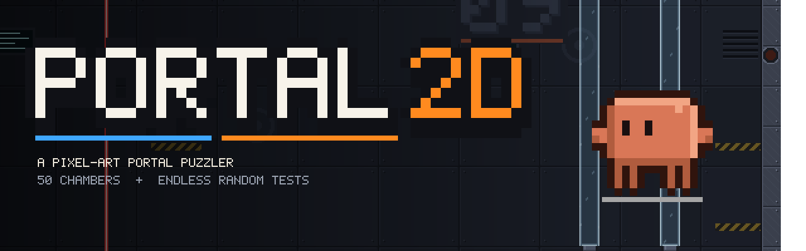
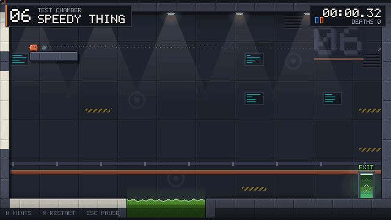
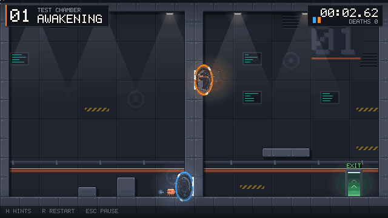
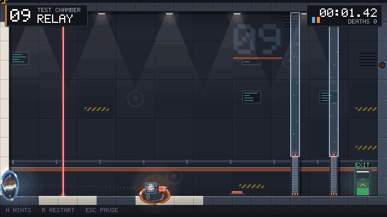
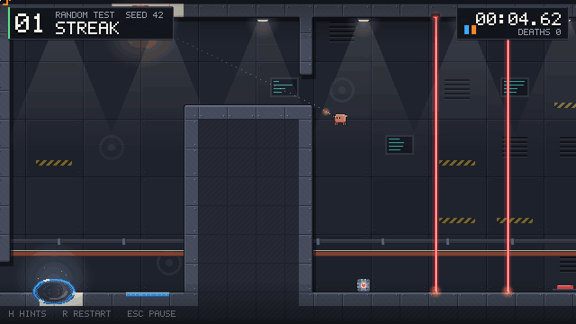
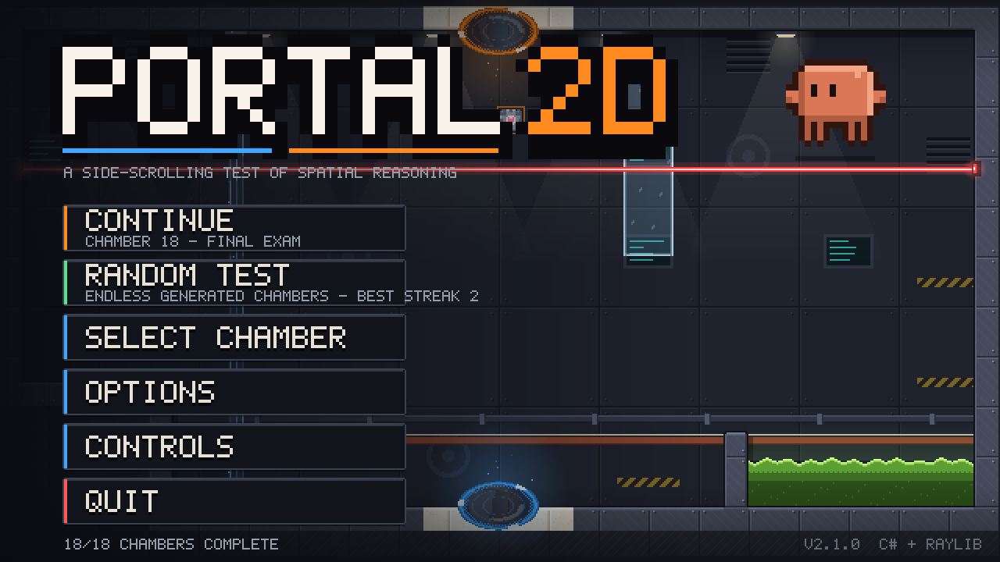
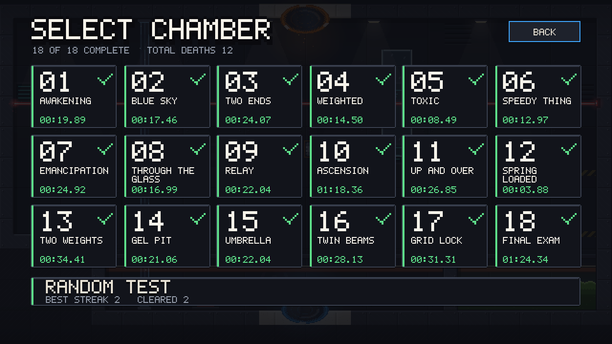
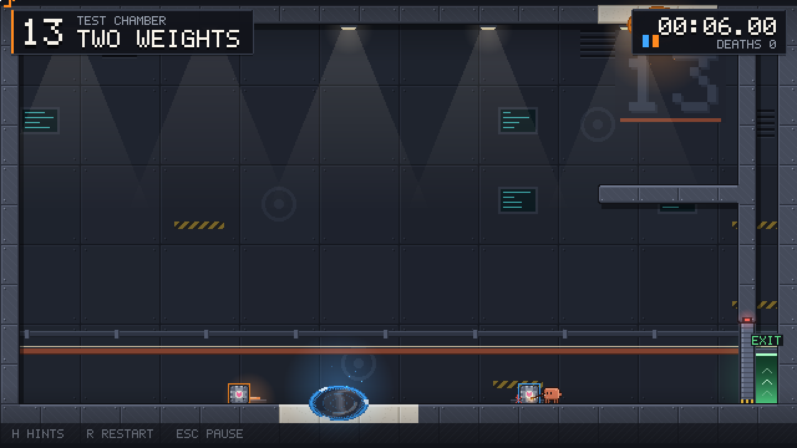
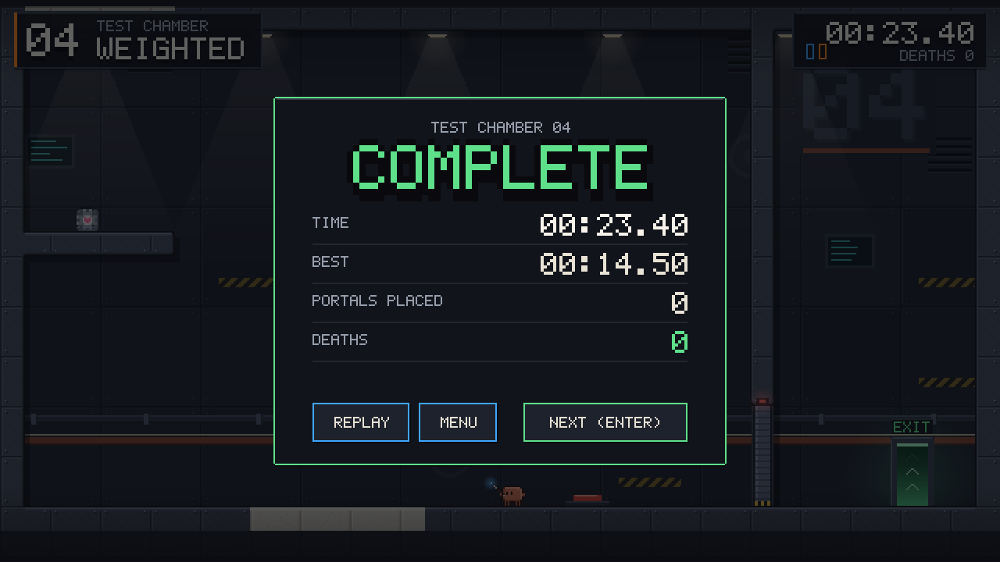
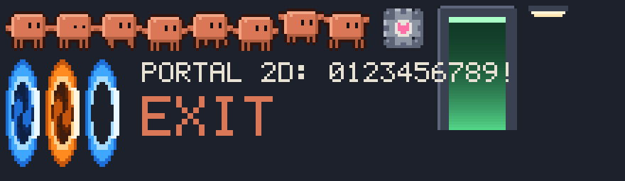

<p align="center">
  
</p>

<p align="center">
  <b>A pixel-art, side-scrolling portal puzzler, written from scratch in C#.</b><br>
  21 handcrafted test chambers, an endless procedurally generated mode,
  and portals you can actually see through.
</p>

<p align="center">
  
  
  
  
</p>

---

<table>
  <tr>
    <td width="50%"><br><sub><b>Speedy thing goes in, speedy thing comes out.</b> Momentum is carried through the portals.</sub></td>
    <td width="50%"><br><sub><b>Portal lenses.</b> Each linked portal shows a live, parallaxed view out of its partner.</sub></td>
  </tr>
  <tr>
    <td width="50%"><br><sub><b>Lasers travel through portals</b>, so you can redirect them into receivers.</sub></td>
    <td width="50%"><br><sub><b>Random Test:</b> endless generated chambers. The game proves every one is solvable before you play it.</sub></td>
  </tr>
</table>

## Features

- **21 handcrafted chambers** that teach and then combine: momentum flings, weighted cubes and buttons, toxic goo,
  emancipation grids, lasers and receivers, glass, and blue repulsion gel.
- **Random Test mode**: endless chambers assembled from randomised puzzle rooms. Each run gets harder, and the game
  tracks your best streak.
- **Portal lenses**: a fragment shader turns each linked portal into a fish-eye window onto the other side, with
  parallax, ripples and a dithered pixel rim.
- **Everything is generated in code**: every sprite, tile, the bitmap font and every sound effect. The game ships no
  art or audio files.
- **One-click updates**: when a new version is out, the main menu offers to download it and restarts the game into it.
- Coyote time, jump buffering, an aim preview that shows where a portal will land, best times, and a pause menu
  with options for volume, screen shake, portal lenses and fullscreen.

<p align="center">
  
  
  
  
</p>

## Download & play

Grab the latest build from the **[Releases page](https://github.com/xandertaylorx/portal-2d-game/releases/latest)**:

| Platform | File |
|---|---|
| macOS (Apple Silicon) | `Portal2D-macOS-arm64-app.zip` |
| macOS (Intel) | `Portal2D-macOS-x64-app.zip` |
| Windows | `Portal2D-win-x64.zip` (run `Portal2D.exe`) |
| Linux | `Portal2D-linux-x64.zip` (run `./Portal2D`) |

> **macOS:** the app is signed but not notarised by Apple. The first time you open it, macOS warns that it can't
> verify the developer. Click **Done**, then go to **System Settings → Privacy & Security** and click **Open Anyway**.
> Or run `xattr -cr "/Applications/Portal 2D.app"` once, using wherever you put the app.

After that, the game checks for updates when it starts. You can turn this off in Options.

### Controls

| Input | Action |
|---|---|
| `A` / `D` | Move |
| `W` / `Space` | Jump (hold for higher) |
| Left mouse | Fire the blue portal |
| Right mouse | Fire the orange portal |
| `E` | Pick up / drop a cube |
| `R` | Restart the chamber |
| `H` | Show / hide hints |
| `Esc` | Pause |
| `F11` | Fullscreen |

## How it works

### One transform for everything
A portal sits on the face of two white tiles and has a centre, an outward normal and an in-plane "up" axis.
Going from portal A to portal B sends `normal(A) → -normal(B)` and `up(A) → up(B)`. Wall portals keep world-up, so
you never come out upside down. Floor and ceiling portals keep world-right, so the direction you were moving is kept.
That single affine map (`Core/Portal.cs`) drives:

- **Teleporting:** position *and velocity* go through the map, which is where flings come from.
- **Sinking in:** the tiles behind a linked portal stop being solid for anything lined up with the opening.
- **Lasers:** a beam that hits a portal face continues out of the other one.
- **Rendering:** the world is drawn a second time through the map into an off-screen texture, so the space in front
  of one portal lines up behind the other.

### Portal lenses
When both portals exist, each one swells into an oval lens. A shader samples the off-screen view behind the
portal, so it shows what is in front of the partner portal. It squeezes that view into the lens with a fish-eye
curve, shifts it with parallax based on where you stand, and adds ripples, a swirl and a dithered, sparkling rim.
Characters passing through are redrawn on the room side, so they never vanish behind the lens.

### Pixel-art pipeline
The game renders to a 640×360 canvas (16 px tiles), scaled up with nearest-neighbour filtering by a whole number.
Tiles and sprites are painted pixel by pixel into CPU buffers (`Render/Pix.cs`). Each level's back wall and solid
tiles are baked into two textures, with auto-tiled outlines, rounded corners, panel seams, ambient occlusion and a
painted chamber number.

### Every level is proven solvable
`Testing/Bot.cs` drives the real physics with scripted inputs. Every handcrafted chamber has a reference solution,
and `--test` plays all of them headlessly. In Random Test, each room archetype writes out the inputs that solve it.
A generated level is only handed to you after the bot has finished it; otherwise the next sub-seed is tried.

<p align="center"></p>

## Building from source

Requires the [.NET 10 SDK](https://dotnet.microsoft.com/download).

```bash
dotnet run --project src/Portal2D -c Release          # play
dotnet run --project src/Portal2D -- --test           # verify every chamber is solvable
dotnet run --project src/Portal2D -- --procgen 50     # generate + verify 50 random chambers
dotnet run --project src/Portal2D -- --preview 9 l9.png   # render a level to PNG without a window
./scripts/shots.sh shots                              # real in-game screenshots
./scripts/make-mac-app.sh                             # local macOS .app in dist/
```

### Releasing an update

1. Add a `## [x.y.z]` section to [CHANGELOG.md](CHANGELOG.md) and commit.
2. Run `./scripts/release.sh x.y.z`.

The script runs the tests, stamps the version, builds macOS, Windows and Linux packages, tags the source, and
publishes a GitHub release on this repo. Running games pick it up and offer the update.

### Project layout

```
src/Portal2D/
  Core/      math helpers, the portal transform
  Game/      simulation and physics, levels, procedural generator, audio synth, save data, updater, screens
  Render/    pixel buffers, sprite + tile painters, bitmap font, renderer, portal-lens shader
  UI/        immediate-mode pixel UI, mechanic icons
  Testing/   input bot, reference solutions, test runner
```

## License

Copyright © 2026 xandertaylorx. Released under the **[PolyForm Strict License 1.0.0](LICENSE.md)**.

You may download, play and study the game for free, for any **non-commercial** purpose. You may **not** sell it,
use it commercially, modify it, or redistribute the code or builds without written permission. All rights not
granted are reserved.

*Portal 2D is an independent fan project. It is not affiliated with or endorsed by Valve Corporation. "Portal" is a
trademark of Valve Corporation.*
